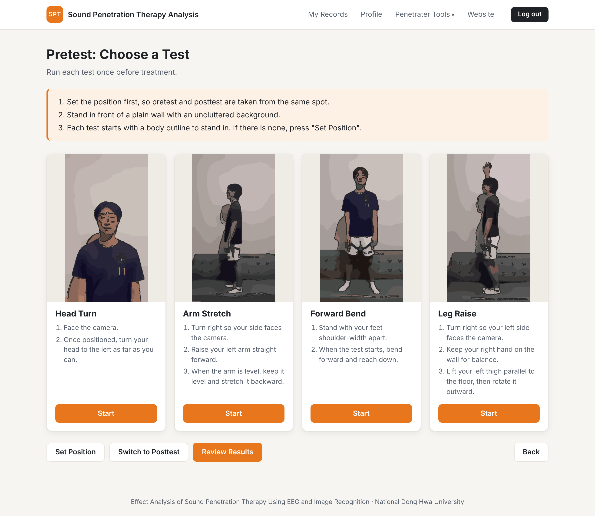
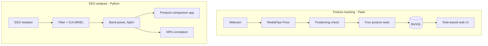
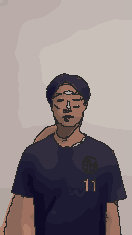
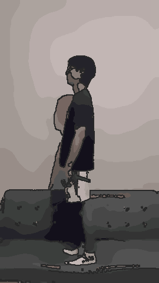
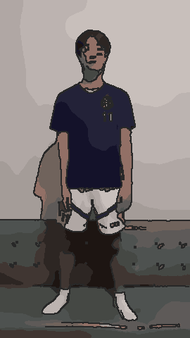
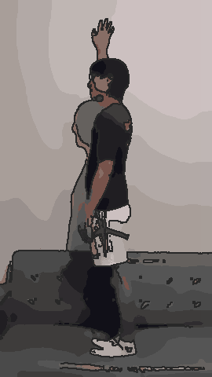
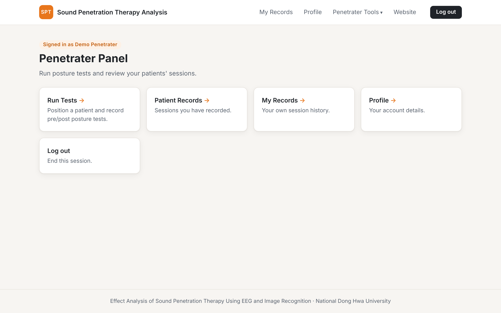
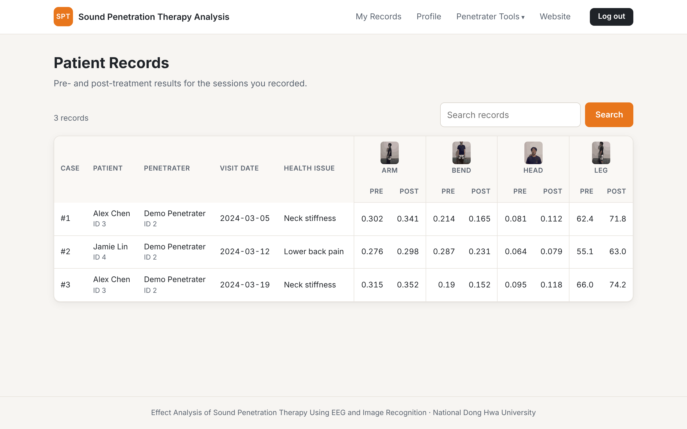

# Effect Analysis of Sound Penetration Therapy Using EEG and Image Recognition

Published in the **IEEE AIxMHC 2025 Conference Proceedings**.

Undergraduate project, B.S. in Computer Science and Information Engineering, National Dong Hwa University (Taiwan). We combined wearable EEG and camera-based posture tracking to measure how a sound penetration therapy session affects patients, and built a web platform that therapists use to run the tests and keep session records.

> This repository is a project overview. The source code is kept private; I am happy to walk through it or share access on request.

## What it does

- **Posture tracking.** A camera and MediaPipe Pose measure four range-of-motion tests (head turn, arm stretch, forward bend, leg raise) before and after treatment. Each test runs live in the browser and saves its result automatically.
- **Consistent positioning.** Before testing, the app captures the patient's silhouette and turns it into an outline. Every later test checks that the patient is standing inside that outline, so pretest and posttest are taken from the same spot.
- **EEG analysis.** Recordings from a wearable EEG headset are filtered, cleaned with ICA, and reduced to band power (theta, alpha, beta), the Delta/Beta ratio and approximate entropy (ApEn). A Streamlit app compares a pretest and posttest recording side by side.
- **Pain correlation.** On the study data, ApEn correlated with patients' pain scores (NRS) at r ≈ 0.81.
- **Session records.** Role-based accounts (admin, penetrater, patient) with a MySQL database. Penetraters run tests and save sessions; patients can view their own results.

## Architecture

## The four posture tests

| Head turn | Arm stretch | Forward bend | Leg raise |
|---|---|---|---|
|  |  |  |  |
| Nose offset from the shoulder midpoint | Wrist distance from the nose with the arm level | Smallest hand-to-foot distance | Knee rotation angle with the thigh raised |

## Screenshots

| Penetrater home | Patient records |
|---|---|
|  |  |

Screenshots use made-up demo data.

## Tech stack

| Area | Tools |
|---|---|
| Computer vision | MediaPipe Pose, Selfie Segmentation, OpenCV |
| Web platform | Flask (blueprints), Jinja templates, MySQL, MJPEG streaming |
| EEG processing | MNE-Python (filtering, ICA, multitaper PSD), SciPy, AntroPy |
| Analysis | pandas, scikit-learn, matplotlib, Streamlit |

## My contributions

- Developed a web-based healthcare analytics platform using Python, Flask, and MySQL.
- Defined validation criteria and test scenarios to verify posture-tracking accuracy across multimodal (EEG + video) data streams.
- Implemented posture analysis with MediaPipe and processed wearable EEG data.
- Integrated multimodal data for visualization and analysis, coordinating requirements across technical and clinical stakeholders.

## Team

Built with my teammates at National Dong Hwa University. The original EEG Streamlit app was created by Mr. Iya Chomchan and Ms. Anunya Boonmak and extended into a pre/post comparison version for this project.
